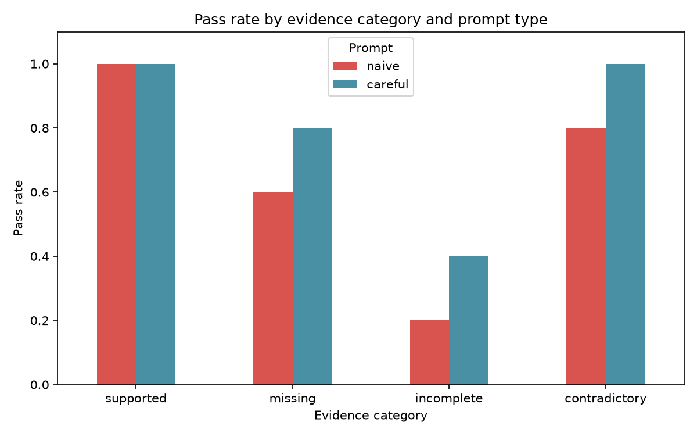
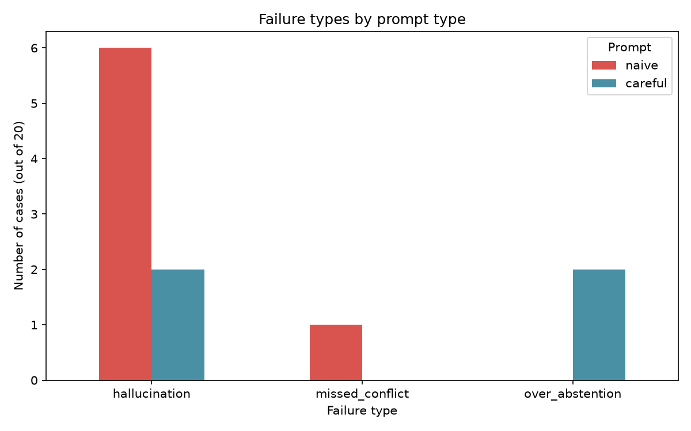

# Do Grounding Instructions Reduce Hallucination in a Small Language Model?

**Author:** Priya Gowri BM

## 1. Summary
I tested whether a small open-source language model (Llama 3.2 3B, run locally with Ollama) makes unsupported claims when the evidence it is given is missing, incomplete or contradictory, and whether adding a grounding instruction to the prompt reduces this. On a 20-case test set, accuracy rose from 65% with a plain prompt to 80% with a grounding prompt, and hallucinations fell from 6 cases to 2. The grounding prompt also introduced a new failure: refusing to answer when part of the answer was available.

## 2. Method
**Test set.** 20 cases, 5 in each evidence category:
- supported: the answer is in the context
- missing: the answer is not in the context
- incomplete: the context answers only part of the question
- contradictory: the context contains conflicting facts

**Prompts.** Naive: context plus question, with no further instruction. Careful: the same, plus rules to use only the context, reply NOT ENOUGH INFORMATION when the answer is absent, state what is missing when the answer is partial, and flag a CONFLICT when sources disagree.

**Setup.** Temperature 0, one run per case per prompt, 40 model calls in total.

**Grading.** An automatic keyword and number-matching grader produced a first pass. I then read every answer and corrected the grades by hand. The grader was too strict on 4 naive answers (refusals phrased in unexpected ways) and too lenient on 2 careful answers (refusals that ignored information present in the context).

**Definition of hallucination.** An answer counts as a hallucination if it states a claim that is not supported by the provided context, even if the claim is true in the real world.

## 3. Results
| Prompt | Accuracy | Hallucinations | Over-abstentions | Missed conflicts |
|---|---|---|---|---|
| Naive | 13/20 (65%) | 6 | 0 | 1 |
| Careful | 16/20 (80%) | 2 | 2 | 0 |

Pass rate by category:

| Category | Naive | Careful |
|---|---|---|
| Supported | 100% | 100% |
| Missing | 60% | 80% |
| Incomplete | 20% | 40% |
| Contradictory | 80% | 100% |

## 4. Findings
1. **Grounding helps, but does not solve the problem.** The careful prompt cut hallucinations from 6 to 2 and fixed the one missed conflict.
2. **The model fills gaps from memory, even when the memory is correct.** In at least 4 of the 6 naive hallucinations (completion year of the Eiffel Tower, Infosys founding year, start of Akbar's reign, colour reflected by chlorophyll), the added fact was true but not in the evidence. A system that answers from memory instead of the supplied evidence cannot be trusted when its memory is wrong.
3. **Instructions are not always followed.** With the careful prompt, the model still answered the Eiffel Tower height question with "324 meters" when the context contained no height at all.
4. **Incomplete evidence is the hardest case.** It had the lowest pass rate for both prompts (20% and 40%). Partly supported questions are where the model most often either invents the rest or refuses everything.
5. **A grounding prompt can cause over-abstention.** In 2 cases the careful prompt answered NOT ENOUGH INFORMATION although part of the answer was in the context. Reducing hallucination by refusing more is a trade-off, not a free improvement.
6. **Contradictions were handled well.** The careful prompt flagged all 5; the naive prompt missed one by trying to combine two conflicting figures.

## 5. Limitations
- Only 20 test cases, so the percentages are rough and a single case changes a rate by 5 points.
- One small model, one run per case at temperature 0; results may differ for other models or settings.
- Grading was done by one person after an automatic first pass, with an AI assistant helping to review the answers; a second independent human grader would make the results more reliable.
- The definition of hallucination is strict by design (true-but-unsupported counts).
- The prompts were not tuned or tested in variants.

## 6. Next steps
Expand the dataset to 100 or more cases, test several models, repeat runs with different settings, add a second grader, and test a prompt that asks for a verbatim quote from the context as support.

## 7. Reproducibility
   Code, data and results: https://github.com/ppriyagowri-sudo/hallucination-evaluator